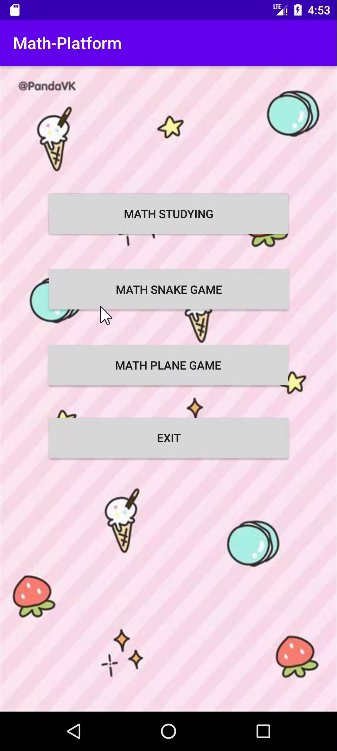
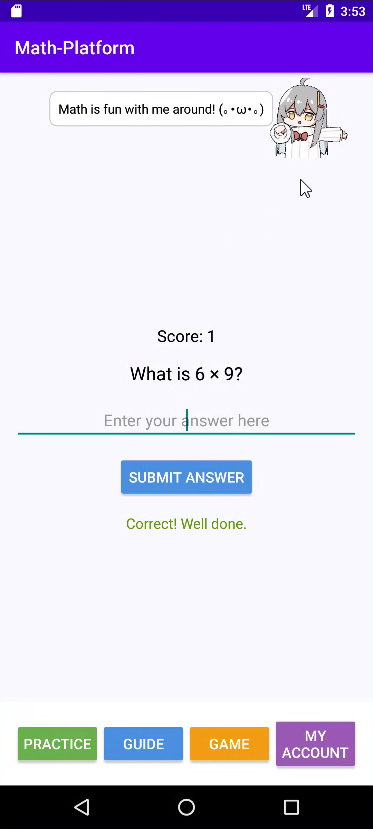
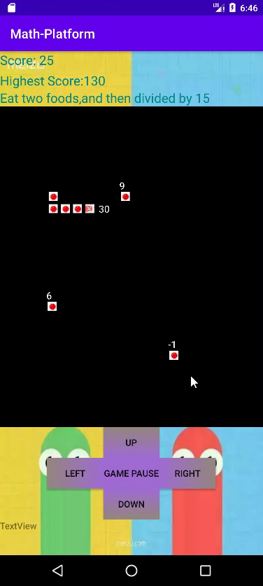
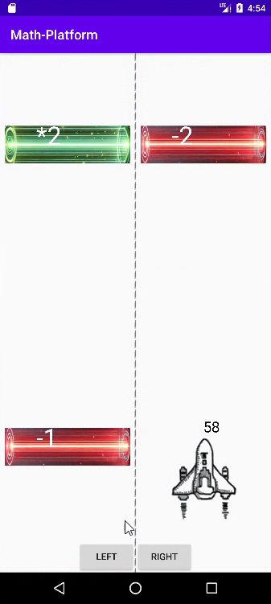

# Math Platform — Android Learning App

Author: Shaohui Jing

A personal Android project for learning mathematics through practice and interactive games, developed with Java, XML and Android Studio.

## Features

- Mathematics practice and a learning dashboard.
- Mathematical Snake and Mathematical Plane games.
- English and Simplified Chinese resources.
- Score visualisation and an interactive pet component.

## Screenshots

Real emulator screenshots captured from the original project demonstration recordings, cropped to show the phone display.

| Main menu | Mathematics practice |
| :---: | :---: |
|  |  |

| Math Snake | Math Plane |
| :---: | :---: |
|  |  |

## Project structure

- `app/`: application source, layouts and resources.
- `gradle/`, `gradlew`, `gradlew.bat`: the original Gradle wrapper.

## Open and run

1. Open the repository folder in Android Studio.
2. Use a JDK compatible with the original Android Gradle Plugin 4.1.1 (typically JDK 8 or 11), and install Android SDK 30 / Build Tools 30.0.3.
3. Sync Gradle and run the `app` module on an emulator or Android device.

The original project uses Gradle 6.x-era dependencies and the JCenter repository. Dependency resolution may require maintenance in a modern Android Studio installation; the application code is preserved as submitted.

## Acknowledgements

The Snake component was adapted from [shen521/Android-Snack](https://github.com/shen521/Android-Snack). The original project README is retained in `docs/upstream-README.md`. Mathematics-specific rules, the Math Platform interface and the Plane game were developed as part of this personal coursework project.
